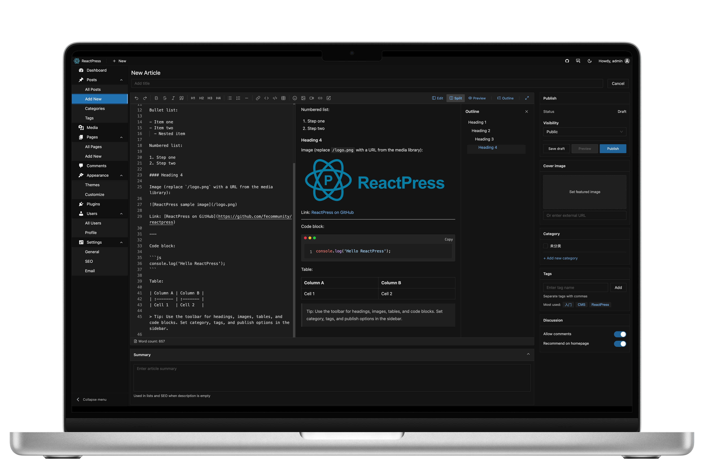
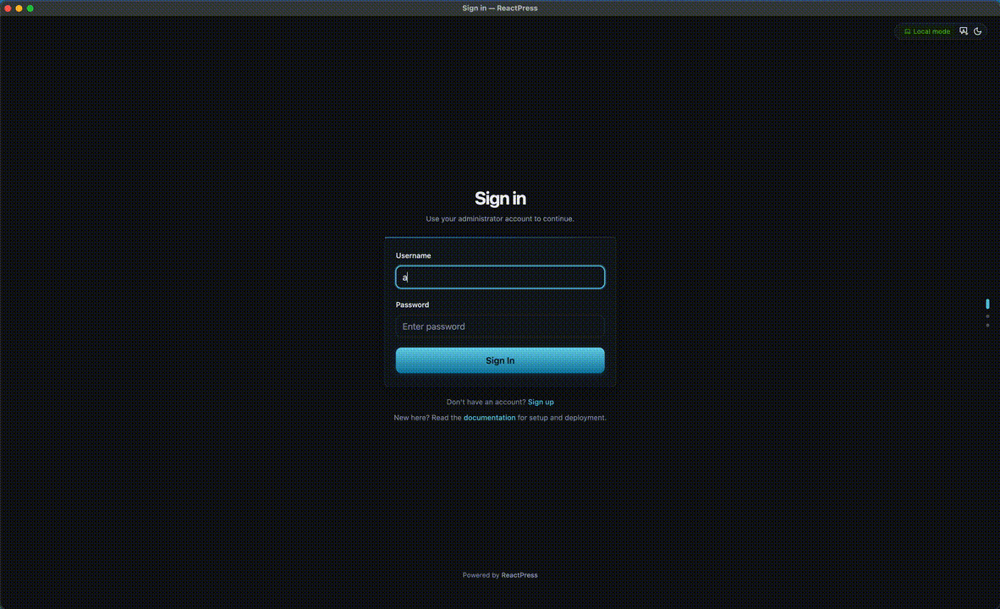
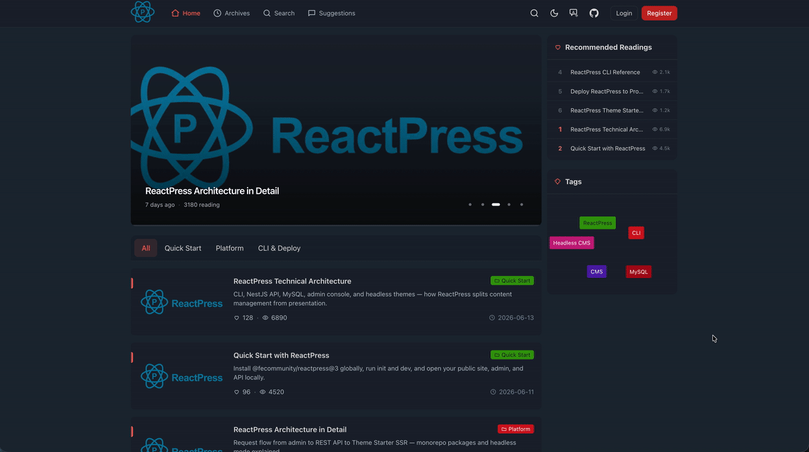
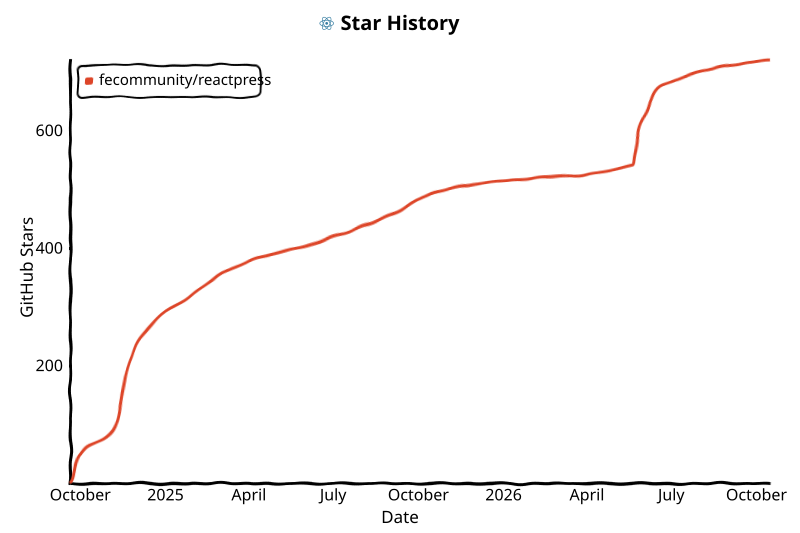

<div align="center">

<a href="https://blog.gaoredu.com" title="ReactPress">
  
</a>



# ReactPress

### 现代化 Web 创作平台

**Build. Manage. Extend.**

写作后台、你掌控的 Next.js 站点，以及可扩展的主题与插件 — 一次安装全有。

[全栈演示](https://blog.gaoredu.com) · [主题演示](https://reactpress-theme-starter.vercel.app) · [文档](https://reactpress.cc/) · [English](./README.md)

[](https://www.npmjs.com/package/@fecommunity/reactpress)
[](https://github.com/fecommunity/reactpress/stargazers)
[](./LICENSE)

</div>

---

## 给谁用

- **独立开发者**：要个人博客、笔记或文档站，内容在自己手里，而不是租用某家 SaaS。
- **小团队**：有人在后台写，有人负责对外站点，不必共用一个 Git 仓库当编辑器。
- **想离开 WordPress 的人**：习惯「打开后台、点发布」，但不想再背一套 PHP 主题。
- **静态站点用户**（Hugo、Hexo、Astro、Next.js Markdown）：已经不想再让非开发者去改仓库发文章。

如果你正在把 Strapi / Payload、后台、前台和部署手动拼在一起 — 这就是做成产品的那条路。

---

## 解决什么问题

对 React 开发者来说，发布内容仍然很别扭：

| 你想要                 | 现实里通常得到                         |
| :--------------------- | :------------------------------------- |
| 不会写代码的人也能发文 | 基于 Git 的静态站                      |
| 站点长得像你自己的产品 | WordPress / Ghost，前台是别人的        |
| 这周就能上线           | Headless CMS，站点、后台、运维还得自建 |
| 飞机上也能写           | 必须开着浏览器和服务                   |

ReactPress 走中间路线：**写的人有编辑器，你有 React 站点，没有人负责拼栈。**

---

## 和常见方案比

|              | ReactPress    | [WordPress](https://wordpress.org) | [Ghost](https://github.com/TryGhost/Ghost) | [Strapi](https://github.com/strapi/strapi) / [Payload](https://github.com/payloadcms/payload) | [Hugo](https://github.com/gohugoio/hugo) / [Astro](https://github.com/withastro/astro) |
| :----------- | :------------ | :--------------------------------- | :----------------------------------------- | :-------------------------------------------------------------------------------------------- | :------------------------------------------------------------------------------------- |
| 谁来发布     | 后台写作      | 后台写作                           | 后台写作                                   | 你还得自己做站点                                                                              | 开发者（Git）                                                                          |
| 对外站点归谁 | 你（Next.js） | PHP 主题                           | Ghost 主题                                 | 另做一套                                                                                      | 你，构建时                                                                             |
| 多久能看到站 | 一条命令      | 安装 + 主题 + 插件                 | 安装 + 主题                                | CMS + 前台 + 胶水                                                                             | 很快 — 直到有人需要 CMS                                                                |
| 离线写作     | 桌面应用      | 无                                 | 无                                         | 无                                                                                            | 本地文件                                                                               |

- **WordPress** — 编辑习惯最好；你也接下 PHP。
- **Ghost** — 独立出版很强；会员/Newsletter 优先，不是你拥有的 React 应用。
- **Strapi / Payload** — 引擎很好；产品还得自己拼。
- **Hugo / Hexo / Astro** — 页面很快；发文仍发生在 Git 里。

---

## 试用

```bash
npm i -g @fecommunity/reactpress
mkdir my-site && cd my-site
reactpress init
```

打开 **http://localhost:3001**（站点）和 **http://localhost:3001/admin/**（`admin` / `admin`）。

需要 Node 20+。默认路径不用 Docker、不用额外数据库。启动失败时运行 `reactpress doctor`。

---

## 看看效果

<div align="center">


<table>
  <tr>
    <td width="50%" align="center" valign="top">
      <a href="./desktop/README.md">
        
      </a>
      <br/>
      <sub>离线写，回来再同步。</sub>
    </td>
    <td width="50%" align="center" valign="top">
      <a href="https://reactpress-theme-starter.vercel.app">
        
      </a>
      <br/>
      <sub>访客真正看到的站点。</sub>
    </td>
  </tr>
</table>

</div>

---

## 接下来

|               |                                                                                                   |
| :------------ | :------------------------------------------------------------------------------------------------ |
| 文档          | [reactpress.cc](https://reactpress.cc/)                                                           |
| 换对外主题    | [themes](./themes/README.md) · [starter](https://github.com/fecommunity/reactpress-theme-starter) |
| 扩展而不 fork | [plugins](./plugins/README.md)                                                                    |
| 桌面写作      | [desktop](./desktop/README.md)                                                                    |
| 部署上线      | [部署文档](https://reactpress.cc/)                                                                |

[参与贡献](./CONTRIBUTING.md) · [更新日志](./CHANGELOG.md) · [MIT 许可证](./LICENSE)

---

<div align="center">

如果这让你少拼一套 CMS、编辑器和前台 — [**给仓库一个 Star**](https://github.com/fecommunity/reactpress/stargazers)。

<br/>

<!-- star-history:start -->
<picture>
  <source media="(prefers-color-scheme: dark)" srcset="public/star-history/star-history-dark.svg">
  
</picture>
<!-- star-history:end -->

</div>
